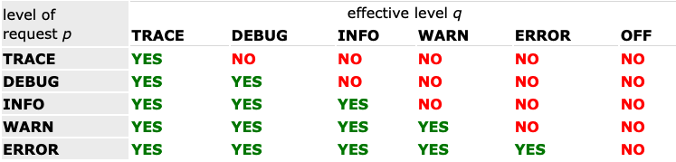

+++
title = "Logging Strategy with Spring"
series = ["Spring"]
date = "2026-06-26"
+++

Dans cet article nous regarder comment spring permet de logger des informations puis les contecter avec Grafana
Cet article s'appuie sur la documentation officielle [Core Features - Logging](https://docs.spring.io/spring-boot/reference/features/logging.html) afin de mettre en oeuvre le logging dans une application d'entreprise

## Unstructured logging
Par defaut lorsqu'on lance une application Spring, c'est [Logback](https://logback.qos.ch/) qui est utilisé

> By default, if you use the starters, Logback is used for logging. Appropriate Logback routing is also included to ensure that dependent libraries that use Java Util Logging, Commons Logging, Log4J, or SLF4J all work correctly.

Et le format de sortie par defaut est le suivant

```
2026-06-27T13:01:06.812+02:00  INFO 23498 --- [demo] [           main] f.a.logging.demo.DemoApplication         : Starting DemoApplication using Java 25.0.2 with PID 23498 (/Users/adriencaubel/Developer/logging_stategy/target/classes started by adriencaubel in /Users/adriencaubel/Developer/logging_stategy)
2026-06-27T13:01:06.813+02:00  INFO 23498 --- [demo] [           main] f.a.logging.demo.DemoApplication         : No active profile set, falling back to 1 default profile: "default"
2026-06-27T13:01:07.030+02:00  INFO 23498 --- [demo] [           main] f.a.logging.demo.DemoApplication         : Started DemoApplication in 0.42 seconds (process running for 0.726)
```

### SFL4J Logger

On utilise la façade SFL4J, qui est automatiquement fournit dans le starter spring

slf4j-dependencie.png

```java
import org.slf4j.Logger;
import org.slf4j.LoggerFactory;
import org.springframework.boot.SpringApplication;
import org.springframework.boot.autoconfigure.SpringBootApplication;

@SpringBootApplication
public class DemoApplication {

	private final static Logger logger = LoggerFactory.getLogger(DemoApplication.class);

	public static void main(String[] args) {
		SpringApplication.run(DemoApplication.class, args);

		logger.info("info");
		logger.warn("warn");
		logger.error("error");
		logger.trace("trace");
		logger.debug("debug");
	}
}
```

Si on relance l'application on constate que seul les 3 premiers log sont affichés
```
2026-06-27T13:07:21.998+02:00  INFO 24214 --- [demo] [           main] f.a.logging.demo.DemoApplication         : Started DemoApplication in 0.307 seconds (process running for 0.536)
2026-06-27T13:07:21.999+02:00  INFO 24214 --- [demo] [           main] f.a.logging.demo.DemoApplication         : info
2026-06-27T13:07:21.999+02:00  WARN 24214 --- [demo] [           main] f.a.logging.demo.DemoApplication         : warn
2026-06-27T13:07:21.999+02:00 ERROR 24214 --- [demo] [           main] f.a.logging.demo.DemoApplication         : error
```

En effet par defaut le `logging.level.root` est définie à INFO. En se référent à la [documentation logback](https://logback.qos.ch/manual/architecture.html) on peut lire

> A log request of level p issued to a logger having an effective level q, is enabled if p >= q. This rule is at the heart of logback. It assumes that levels are ordered as follows: TRACE < DEBUG < INFO <  WARN < ERROR. 



Ainsi, avec log level à info seul info, warn et error qui sont suppérieur à info sont affichés
On peut changer dans `application.properties` la propriété `logging.level.root=DEBUG` pour avoir les log de debug

```
2026-06-27T13:13:00.223+02:00  INFO 24417 --- [demo] [           main] f.a.logging.demo.DemoApplication         : info
2026-06-27T13:13:00.223+02:00  WARN 24417 --- [demo] [           main] f.a.logging.demo.DemoApplication         : warn
2026-06-27T13:13:00.223+02:00 ERROR 24417 --- [demo] [           main] f.a.logging.demo.DemoApplication         : error
2026-06-27T13:13:00.223+02:00 DEBUG 24417 --- [demo] [           main] f.a.logging.demo.DemoApplication         : debug
```

### Ajouter une entrée via MDC

> You can add MDC and other ad-hoc content to log lines by overriding only the LOG_LEVEL_PATTERN (or logging.pattern.level with Logback). For example, if you use logging.pattern.level=user:%X{user} %5p, then the default log format contains an MDC entry for "user", if it exists, as shown in the following example.

Dans application.properties on ajoute la ligne suivante `logging.pattern.level=user:%X{user} %5p` 


```java
@SpringBootApplication
public class DemoApplication {

	private final static Logger logger = LoggerFactory.getLogger(DemoApplication.class);

	public static void main(String[] args) {
		SpringApplication.run(DemoApplication.class, args);

		MDC.put("user", "adrien");

		logger.info("info");
	}
}
```

```
2026-06-27T13:15:30.316+02:00 user:adrien  INFO 24473 --- [demo] [           main] f.a.logging.demo.DemoApplication         : info
```

Note : ceci est très utile dans un contexte multi-tenant pour pouvoir filtrer les logs par tenant dans grafana par exemple


### Ajouter Opentelemetry
Ici, on va utiliser l'image docker [grafana-lgtm](https://github.com/grafana/docker-otel-lgtm)

`docker run -p 3000:3000 -p 4318:4318 -p 4317:4317 grafana/otel-lgtm:latest`

Puis dans notre projet on va rajouter la 